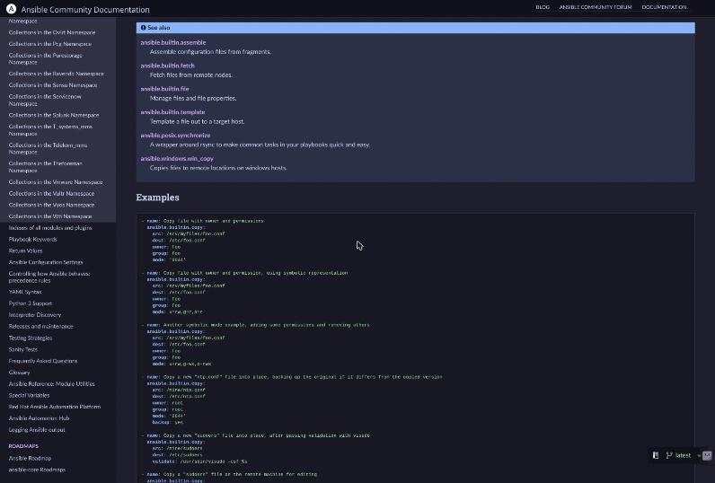
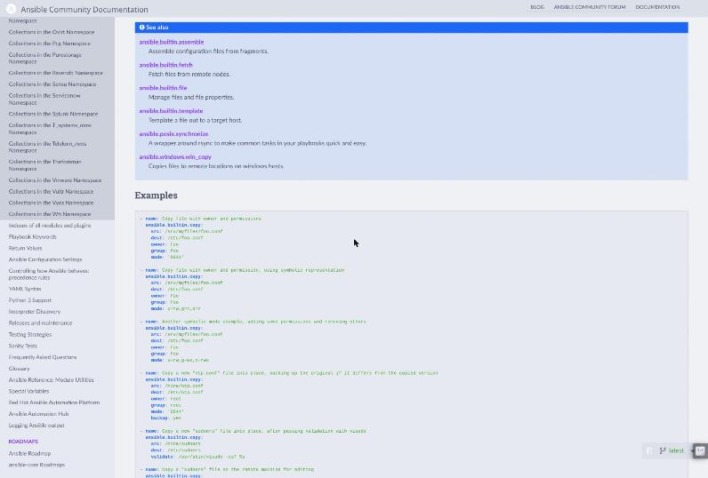

# Ansible Docs Catppuccin

Catppuccin for [docs.ansible.com](https://docs.ansible.com). The site runs three engines under one domain, and the style covers all three:

- the Sphinx docs (the Ansible package docs, collections, module and plugin pages, most `/projects/` pages), including the Read the Docs flyout, search and notifications,
- the landing pages (`/`, users, ecosystem and the other Nikola pages),
- the MkDocs Material docs (Ansible Lint, Navigator, Molecule, the dev tools and the other MkDocs projects).

| Mocha | Latte |
|---|---|
|  |  |

## How the flavor is chosen

- **Sphinx docs and landing pages** have no dark mode of their own, so they follow your system: Dark Flavor when it is dark, Light Flavor when it is light.
- **MkDocs docs** have their own light/dark toggle in the header, and the style follows it: Light Flavor for the light scheme, Dark Flavor for the dark one.

## Known gaps

- Diagrams and screenshots in the docs are pictures and keep their colors.
- Buttons in the Sphinx docs keep the theme's faint white bevel at the top edge.

## Verified

| Date | Pages | Result |
|---|---|---|
| 2026-10-29 | Sphinx: Getting started, `ansible.builtin.copy` module; landing page `/`; MkDocs: Ansible Lint home and the `yaml` rule page, both schemes | No color outside the active flavor's palette on any visible element, in Mocha, Frappé, Macchiato and Latte. In Mocha, all 1,542 color declarations of the earlier Mocha-only style render the same. |
