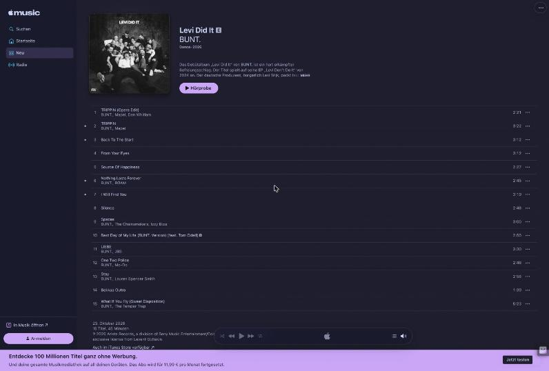
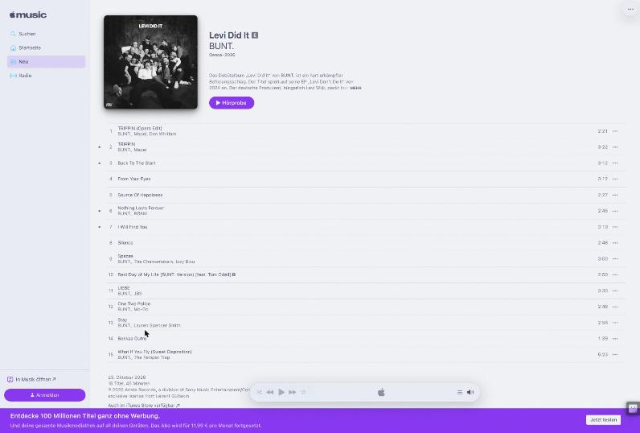

# Apple Music Catppuccin

Catppuccin for Apple Music on the web ([music.apple.com](https://music.apple.com) and the beta): the sidebar, browse pages, album and playlist pages, the player and the upsell banner.

| Mocha | Latte |
|---|---|
|  |  |

## How the flavor is chosen

Apple Music has no appearance setting of its own on the web, so the style follows your system: Dark Flavor when it is dark, Light Flavor when it is light.

Album and playlist pages normally take a color from the artwork. The style keeps them on the flavor instead.

## Known gaps

- The play and "more" buttons that appear over artwork keep Apple's translucent dark overlay, and text printed on editorial artwork stays white. Both sit on pictures.
- The music video player ships its own copy of the colors inside its shadow root and is not themed.
- With the system in light mode, Apple gives albums with light artwork a light theme of their own. The style maps it like the dark one, but that case was not seen live (see below).

## Verified

| Date | Pages | Result |
|---|---|---|
| 2026-10-29 | New (`/de/new`) and an album page with dark artwork, with the system in dark mode | No color outside the active flavor's palette on any visible element except the overlays on artwork listed above, in Mocha, Frappé, Macchiato and Latte. Latte was checked by building it as both flavors; Frappé and Macchiato by swapping the palette in the Mocha build. |
