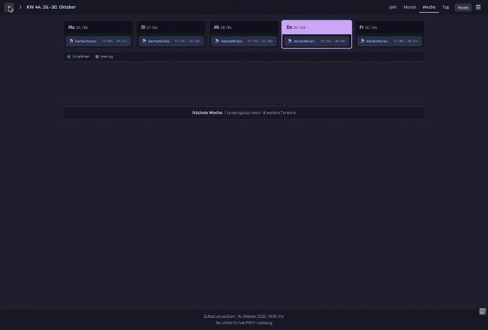
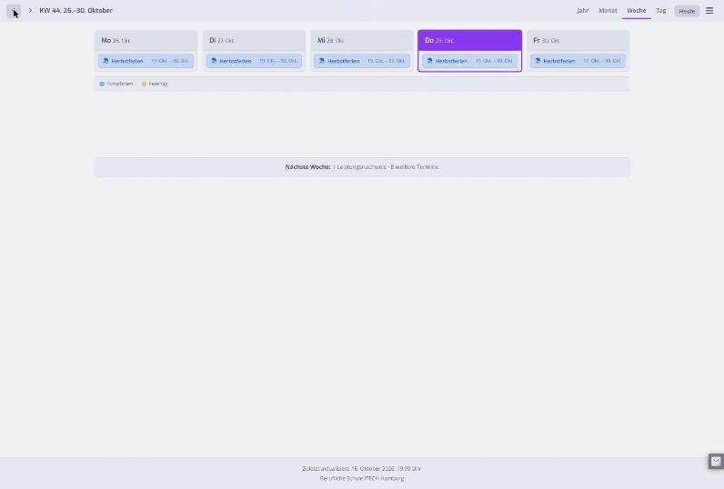

# ITECH-Kalender Catppuccin

Catppuccin for the class calendars of the Berufliche Schule ITECH Hamburg ([itech-bs14.codeberg.page/ITECH-Kalender](https://itech-bs14.codeberg.page/ITECH-Kalender/)): the year, month, week and day views, the event cards and the menu. Event categories keep their distinct colors, mapped onto the palette.

| Mocha | Latte |
|---|---|
|  |  |

## How the flavor is chosen

The calendar has no dark mode of its own, so the style follows your system: Dark Flavor when it is dark, Light Flavor when it is light. Printing keeps the calendar's own light print style.

## Known gaps

- QR codes keep a white background, so phones can still scan them.

## Verified

| Date | Pages | Result |
|---|---|---|
| 2026-10-29 | A class calendar: year, month, week (a holiday week and a full week) and day view, expanded event cards, the menu | No color outside the active flavor's palette on any visible element, in Mocha, Frappé, Macchiato and Latte. |
