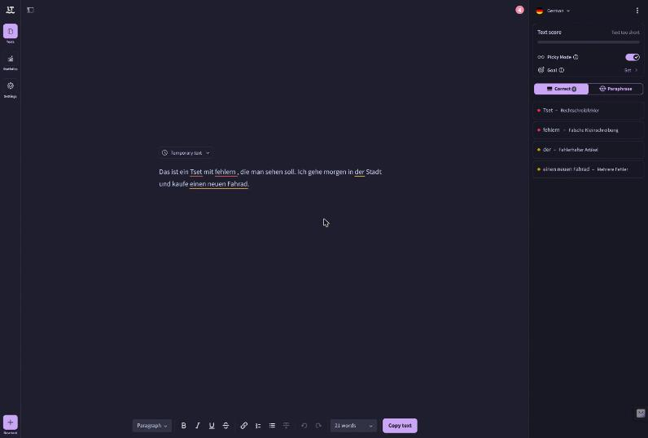
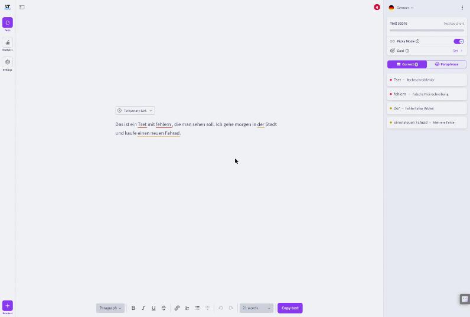

# LanguageTool Catppuccin

Catppuccin for [languagetool.org](https://languagetool.org): the editor, its sidebar and error cards, and the in-page widgets.

| Mocha | Latte |
|---|---|
|  |  |

## How the flavor is chosen

The style follows LanguageTool's own appearance setting (Settings, Appearance). **Dark** uses your Dark Flavor, **Light** your Light Flavor, and **Default** follows your system.

## Known gaps

- The mascot illustrations are pictures and keep their colors.
- The small clock icon next to the selected document in the document list stays blue. It sits on the same element as the title, so recoloring it would recolor the title too.
- The LanguageTool browser extension on other sites is not covered.

## Verified

| Date | Site build | Pages | Result |
|---|---|---|---|
| 2026-10-29 | `app-en.js` id `d113b2aa` | editor (empty and with spelling, grammar and article errors), sidebar, error card, suggested fix | No color outside the active flavor's palette on any visible element, in Mocha, Frappé, Macchiato and Latte, light and dark mode. |
